# 中国历史 · 山河变迁

一个以完整历史年代导航、真实地貌底图及有来源的疆域时段为核心的历史地理阅读原型。《资治通鉴》是可一键聚焦的阅读专题。

## 运行

```bash
npm install
npm test -- --run
npm run build
npm run dev
```

打开终端提示的本地地址即可使用。也可以用 `npm run preview` 查看生产构建。

当前版本仅供本地研究与走查。公开部署前必须补录有效审图号、有效期与发布所需标识，并确保 `npm run verify:map-release` 通过；不得把普通 `npm run build` 视为地图发布合规验收。

仓库已具备子路径构建、公开产物审计和最小权限 Pages 工作流骨架，但当前门禁会主动阻止上传和部署。启用条件、private 源仓与 public 产物仓选择、验收、回滚和停止条件见 [静态站点发布手册](docs/release/public-static-site-runbook.md)。

## 功能速览

山河年轮把历史时间导航、可追溯的疆域资料和历史知识阅读放在同一张可交互地图上。当前版本提供：

- **跨越古今的时间导航**：从公元前8000年至2026年浏览历史时期，按朝代、事件和资料节点定位；支持逐年播放、精确跳转及《资治通鉴》专题范围。
- **有来源的历史地图**：查看中国及周边政权的来源时段疆域、历史地名和同期世界疆域；区分疆域、文化核心、控制中心、影响范围及资料缺口，不把缺年自动插值成确定边界。
- **事件与知识阅读**：浏览精选历史转折、背景、经过、影响和出处；地图、年份与详情联动。长安城市专题提供政权、人物、事件、遗产等知识关系的试点阅读入口。
- **适配不同设备的探索工作台**：桌面与手机均可使用地图、时间控制器、事件和详情面板；支持底图切换、多语言、触屏与键盘操作。

具体交互、数据口径和研究限制见下文「当前功能」与「数据说明」。

## 功能案例

以下截图来自项目实际工作台验收。点击图片可查看原图。

### 时间轴与同期世界

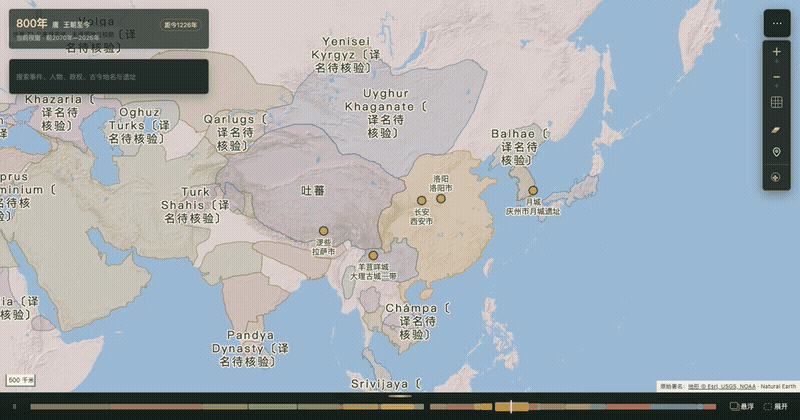

[下载 MP4 演示](docs/media/chronoatlas-project-demo.mp4)。演示先通过时间轴切换800年、1271年和1912年，展示同期世界疆域随所选年份更新；随后展示唐代时间范围聚焦、长安城市视角和李世民人物详情。地图数据按来源时段显示，演示中的年份断面不表示所有地区都已有逐年考证资料。

| 案例 | 预览与说明 |
| --- | --- |
| 历史疆域与时间导航 | [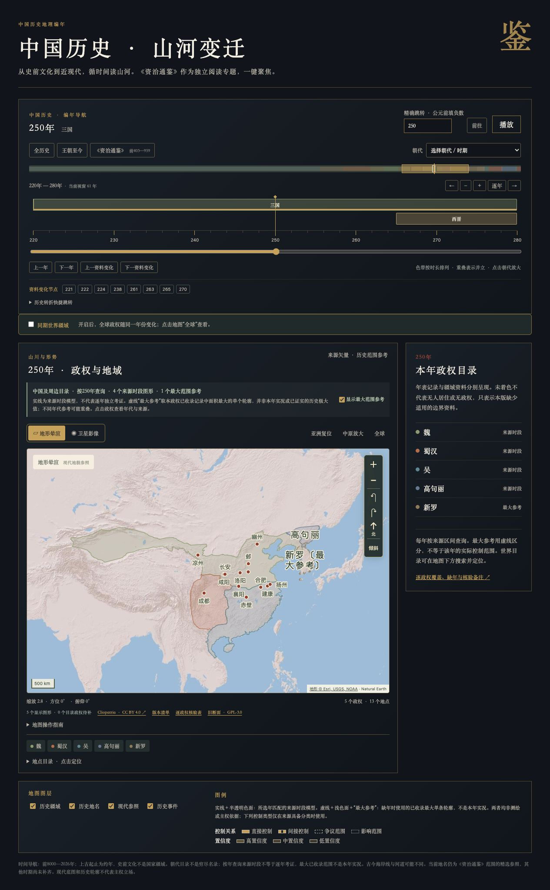](docs/2026-10-18-三国疆域验收.jpg)<br>按所选年份浏览三国时期来源疆域。 |
| 同期世界疆域 | [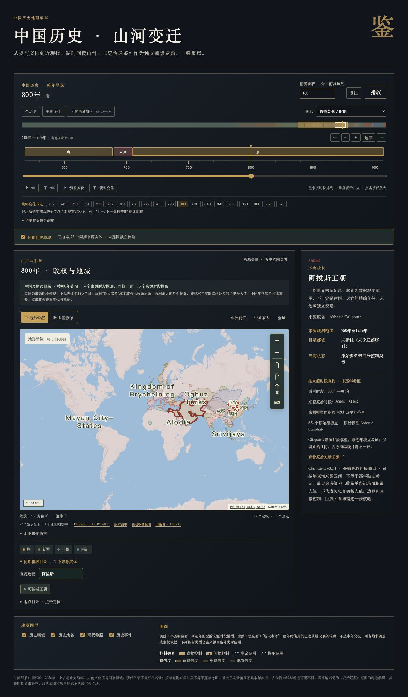](docs/2026-10-18-同期世界验收.jpg)<br>在同一历史断面查看世界政权分布。 |
| 事件工作台（桌面） | [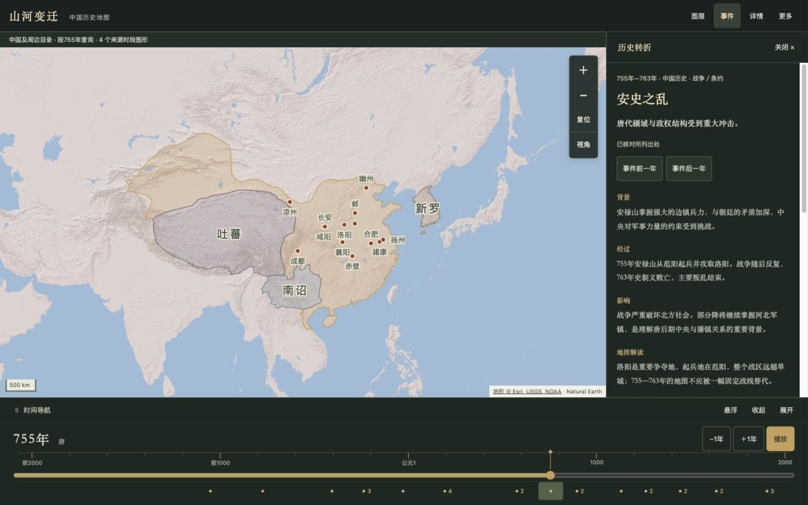](docs/2026-10-19-桌面事件工作台.png)<br>事件目录与地图联动，查看历史背景及来源。 |
| 移动工作台 | [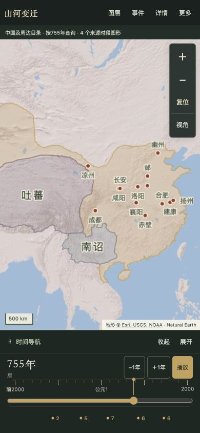](docs/2026-10-19-移动工作台.png)<br>手机布局下浏览地图和时间控制器。 |
| 时间导航与王朝时期 | [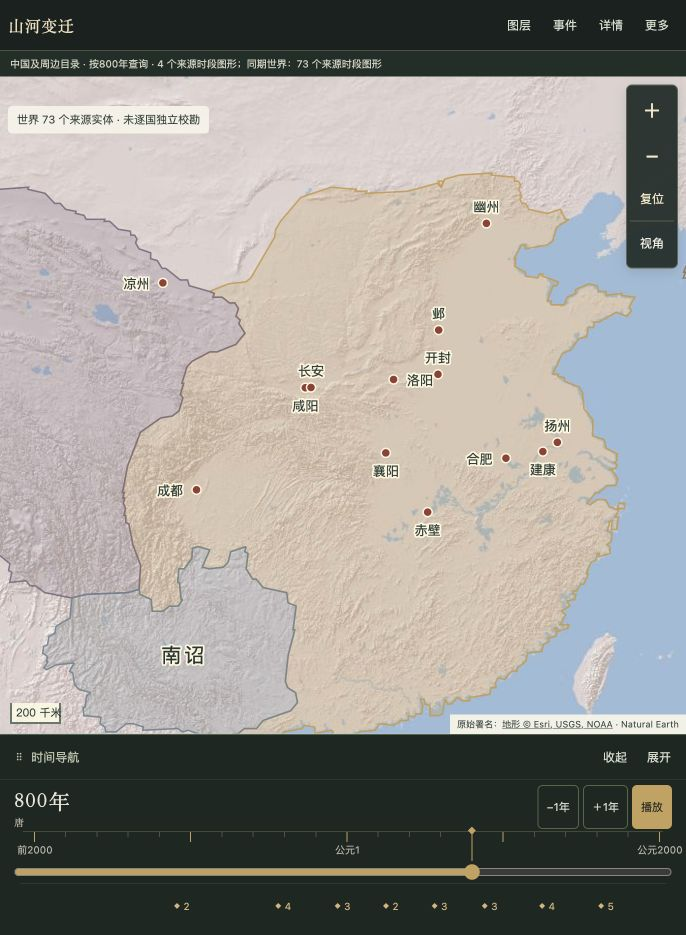](docs/screenshots/2026-10-21-timeline-before-800.png)<br>时间轴显示当前年份、朝代和历史资料节点，可展开进行精确浏览。 |
| 年份切换与政权资料 | [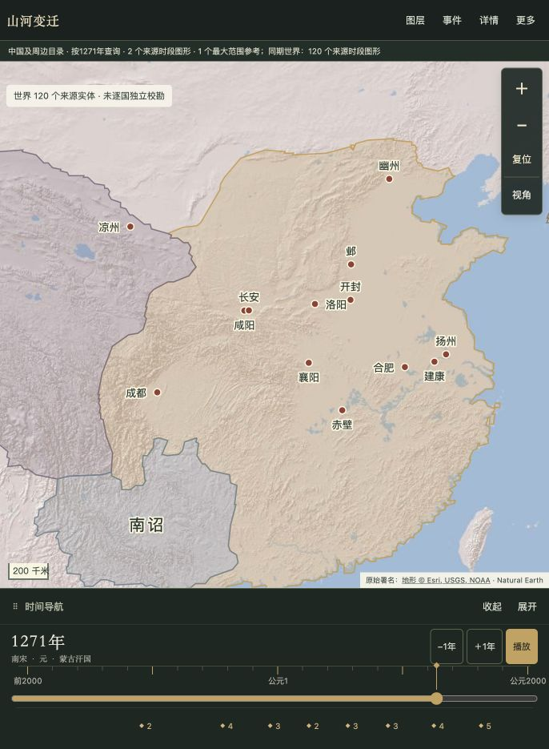](docs/screenshots/2026-10-21-timeline-after-1271.png)<br>切换年份后，地图状态、政权信息和时间轴年份同步更新。 |
| 同期世界与政权详情 | [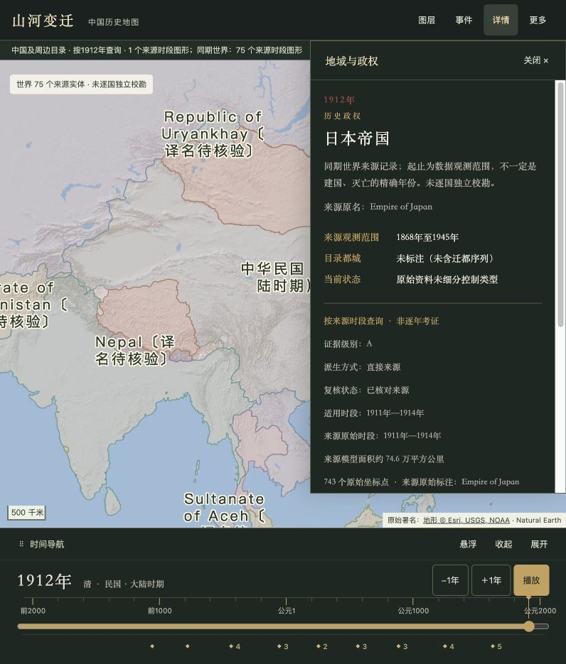](docs/screenshots/2026-10-21-timeline-1912-world.png)<br>开启同期世界图层后查看全球历史资料，并从地图进入政权详情。 |
| 朝代时间范围 | [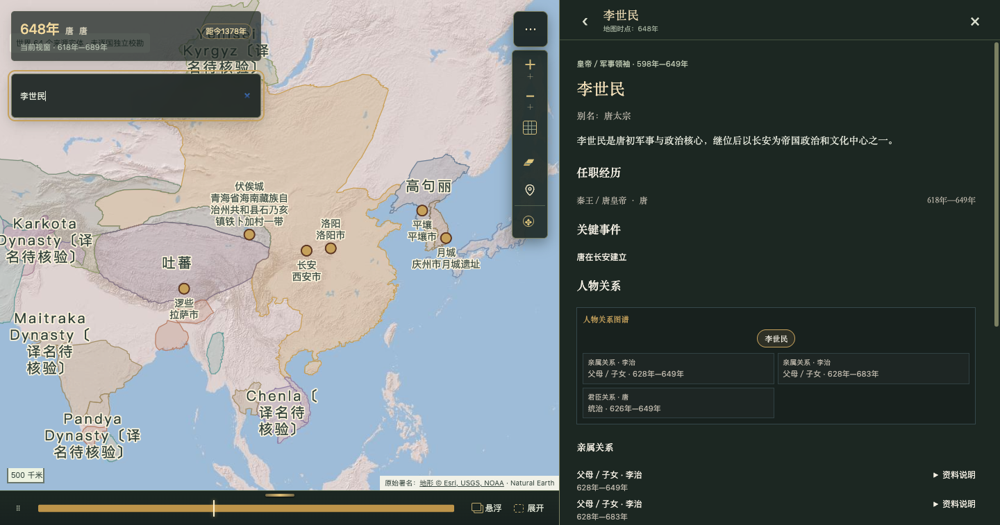](docs/media/chronoatlas-dynasty-tang.png)<br>点击时间轴上的唐代时期聚焦朝代时间范围。 |
| 城市视角：长安 | [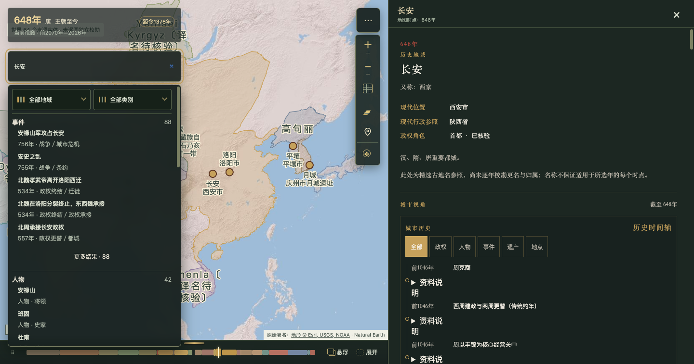](docs/media/chronoatlas-city-changan.png)<br>按年份查看城市沿革、政权、事件及相关历史地点。 |
| 人物主线：李世民 | [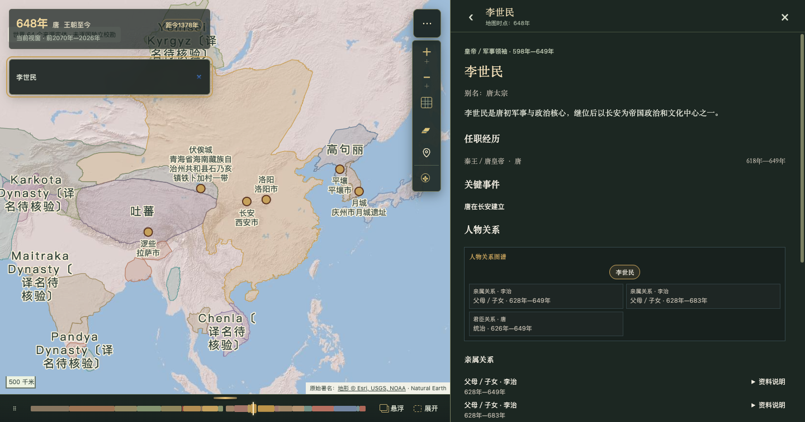](docs/media/chronoatlas-person-li-shimin.png)<br>查看人物年代、任职、关键事件和人物关系。 |

城市与人物视角已在长安试点中实现，包含城市历史时间轴、人物详情及其关联政权、事件和遗产。相关数据范围与交互验收见[知识图谱与长安试点阶段验收](docs/2026-10-21-知识图谱与长安试点阶段验收.md)。

## 迭代路线

路线按当前代码与研究记录整理；后续优先级可能随资料核验和发布条件调整。

| 阶段 | 状态 | 方向 |
| --- | --- | --- |
| 交互工作台与时间导航 | 已完成首轮 | 持续维护地图、时间轴、事件、详情和多语言之间的联动与桌面／移动端可用性。 |
| 历史知识图谱与城市视角 | 试点已实现，继续扩展 | 以长安试点的数据契约为基础，逐步扩展洛阳、南京、北京等城市；补齐政权沿革、首都序列、人物、事件和遗产之间的时空关系。 |
| 疆域资料逐年复核 | 分批进行 | 按研究台账逐年补充来源与范围判断，完成独立历史审核、制图审核、权利审核和公开展示审核；只有全部通过的资料才进入发布数据。留空和点位参照也是有效研究结果，不以填满地图为目标。 |
| 资料可追溯与阅读体验 | 持续完善 | 深化证据、来源、置信度和不确定性的展示，完善关系筛选、人物时间线及来源核验状态。 |
| 发布准备与性能 | 发布门禁未通过前不部署 | 完成地图发布合规材料和审图信息，优化首屏几何、资源分包与移动网络加载；通过发布手册规定的验收后再评估公开部署。 |

疆域复核批次、审核边界和当前进展见[研究台账基线](docs/audits/2026-10-25-territory-research-backlog.md)及[批次复核小结](docs/audits/2026-11-03-territory-batch-review-summary.md)。路线图中的“已完成”仅指对应的软件能力，不代表相关历史资料已全部考证或获准公开发布。

## 当前功能

- 全屏自适应地图工作台；桌面时间控制器可停靠、悬浮、拖动及键盘微调，手机提供收起／精简／展开三档。辅助内容按需打开，不再将地图推到长页面顶部。
- 历史转折目录收录26条精选事件（中国21条、同期世界5条），可搜索和筛选，阅读背景、经过、影响与出处；跨年事件在持续区间内可查。点击事件联动年份但不强制移动镜头。
- 时间导航覆盖前8000年至2026年，跳过公元0年；史前及夏商周早期使用约年分期，不意味着已有逐年史料。
- 朝代按时长排列，并立时期分行；支持朝代聚焦、刻度缩放、视窗平移、逐年步进、输入跳转和播放。
- 全历史、王朝至今、《资治通鉴》（前403—959年）快捷范围；前后资料变化节点可跳转，政权详情可比较已收录时段。
- 时间轴、历史疆域、政权、历史地名和详情面板同步更新。
- 默认亚洲重点视图，可一键切换到中原或全球。
- 真实地形晕渲与自然色卫星影像自由切换，保持当前缩放、方向和俯仰。
- 卫星影像自动使用更高饱和度、较深填充和较强描边；直接、间接、争议、影响及最大参考在选中后仍保留各自线型。
- “更多”可切换大陆简体、香港繁体、台湾繁体和英文；界面、日期、比例尺、地图标签、地点及26条事件正文同步变化，语言选择保存在当前浏览器。
- 支持滚轮、双击、触屏捏合缩放；拖动平移；旋转、俯仰和一键复位。
- 点击历史疆域或历史地名可以查看相关信息。
- 图层可以分别开关：历史疆域、历史地名、现代参照和历史事件。
- 按所选年匹配来源时段；缺年时显示同政权“最大已收录范围”虚线参考，可单独隐藏，不进行跨年插值。
- 可开启“同期世界疆域”，按世纪加载并按当前年筛选；世界目录支持中英文搜索、地图定位。

## 地图操作

### 沉浸式探索模式

地图默认作为主场景显示，顶部只保留轻量 HUD，时间控制器默认收起在底部。顶部不再常驻产品标题，图层、事件、详情和更多以图标工具入口呈现；缩放控制条内的 ◈ 入口可直接切换图层、底图和同期世界，不必打开侧栏。需要精确研究时，可展开时间控制器并进入分析密度；再次收起即可回到地图优先的浏览状态。

- 时间轴的王朝、专题和资料节点是可逆的“视窗下钻”，左侧返回按钮会恢复上一级时间范围，不会把当前年份偷偷改走。
- 选择地点、政权或事件后，地图会保存上一个镜头；右侧“返回”按钮可恢复上个视角。
- 事件详情提供“返回事件列表”，移动端面板外点击遮罩或按 Escape 可关闭，避免进入详情后失去上下文。
- 底部时间条、地图右侧导航和面板都保留键盘焦点与触屏操作；系统开启减少动态效果时会自动降低界面动画。

| 操作 | 鼠标 / 键盘 | 触屏 |
| --- | --- | --- |
| 缩放 | 滚轮、双击、＋/− 按钮；地图聚焦后按加减键 | 双指捏合 |
| 平移 | 左键拖动；地图聚焦后按方向键 | 单指拖动 |
| 旋转 | 右键左右拖动、旋转按钮；Shift＋左右方向键 | 双指旋转 |
| 俯仰 | 右键上下拖动、“倾斜”按钮；Shift＋上下方向键 | 双指上下拖动 |
| 复位 | “北”恢复正北和平视；“亚洲复位”恢复起始视角 | 同名按钮 |

“地点目录”支持键盘选择并放大定位。古地名自动避让，现代位置参照在较大缩放级别显示。年份切换只更新历史覆盖层，不重置视角。

右侧图标工具只保留事件、详情和说明面板；图层、底图和同期世界统一收纳在地图控制条内，避免重复入口。控制条还提供平铺与球形视图切换，切换不重建地图、不清空图层或重置镜头。面板可独立滚动，Escape 关闭后焦点返回入口。展开时间控制器可使用精确年份输入、朝代选择及《资治通鉴》快捷范围。

地图右下角的必要来源署名保持可见，不提供删除署名的开关。浮动位置和停靠偏好保存在当前浏览器；手机强制停靠，但保留桌面偏好。

翻译只作用于展示副本，不修改史料、实体ID或几何。英文检索仍可匹配已收录中文原名；来源机构、许可证、数据集署名和原文献标题按原文保留，但会以当前界面语言标明“来源原始标注”“来源文献原题”或“原始署名”。地图、政权目录与详情共用同一组本地化实体标签。同期世界实体如没有经过核验的中文译名，会保留来源原名并明确标注“中文译名待核验”，不自动生成音译；这不代表所有世界实体已有经过学术核验的中文名称。

地形与卫星瓦片需要联网，来源署名位于地图右下角；加载失败时保留本地陆地轮廓与历史图层，并提供重试。地图需要浏览器支持 WebGL。俯仰调整的是观察角度，当前未加入高程网格驱动的三维山体。

## 数据说明

已删除旧版手绘示意多边形与自动补形逻辑。新增 Cliopatria v0.2.1（Bennett 等 / Seshat Global History Databank，CC BY 4.0），保留原始几何：

- 中国历史及周边目录共87个政权，其中85个有A/B级来源疆域，共625条直接导入记录；夏代和更始政权另以D级文化核心／控制中心显示，不计作确定国界。记录数不是独立地图数或已考证年份数。
- 同期世界11,402条记录、1,458个来源实体，按55个世纪文件加载；来源覆盖前3400—2024年。实体并非全部都是独立国家，世界记录尚未逐国校勘。
- 保留 André Ourednik / Historical Basemaps（GPL-3.0）的24个年份、51个旧断面，只在没有适用新时段且恰好同年时补充。

**按年可查不等于逐年已考证。** 缺年时，只有决策账本明确记录后才显示C级“最大参考”，不声称是历史真实极大值或所选年的实际疆域。可能与同期轮廓重叠，可取消“显示最大范围参考”。夏代只显示二里头D级文化核心，更始政权只显示宛城、洛阳、长安D级控制中心；两者都不是封闭国界。

现有15个精选古地名（含二里头与宛城）仍是定位参照，尚未逐年校勘更名及归属；新扩展时期的地名待补。默认打开800年。

事件是精选目录，并非完整历史年表。22条标注已核对所列出处、4条部分核验；这些标签不代表所有历史争议已解决。本批没有独立核验坐标，因此不生成事件定位点，也不把历史地名关联当作精确事件地址。详见 [事件资料核验](docs/2026-10-18-事件资料核验.md) 和 [工作台验收记录](docs/2026-10-19-工作台与事件验收.md)。

来源、许可、排除记录与扩展规则见 [docs/data-sources.md](docs/data-sources.md)。第三方几何数据许可证与 SHA-256 清单保存在 `public/data/`，发布或改作其他用途时需要保留并遵守原许可。繁体转换使用 OpenCC JS，其 MIT 许可证和第三方声明位于 `public/data/licenses/`。

从 [Cliopatria v0.2.1](https://github.com/Seshat-Global-History-Databank/cliopatria/tree/v0.2.1) 下载并解压原始GeoJSON，用Node 24重新生成：

```bash
node scripts/import-cliopatria.mjs /absolute/path/cliopatria_polities_only_v021.geojson
npm test -- --run
npm run build
```

逐政权覆盖表为仅供研究和构建流程使用的 `internal/audits/coverage-audit.json`，不会进入公开站点；版本及输入哈希在 `public/data/cliopatria-manifest.json`。重新导入旧断面（需要联网，原始文件缓存于 `/tmp/china-history-boundaries-source`）：

```bash
node scripts/import-boundaries.mjs
npm test -- --run
```

内部年份采用带符号整数：负数表示公元前，正数表示公元；连续索引跳过公元0年，刻度和图形位置共用同一索引。

当前中国几何仍在首屏脚本中，生产构建有大文件提示；世界只按需加载相关世纪，最大分片约19.9 MB。公开部署前宜继续做几何去重、分包和网络压缩优化，本地验证不等于移动网络性能验收。
